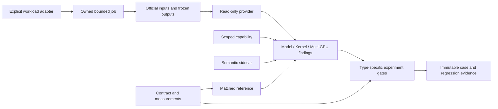

# R0/R1 architecture and contracts

The implementation below describes the current alpha. The accepted
[thin-tool boundary](adr-0004-thin-tool-boundary.md) narrows the next architecture:
application integration and optimization workflows move to consuming projects;
generic capture, query, summaries and official viewing remain. That migration is
not yet complete.

`rdnascope` is a portable offline core. Core imports never import a model, Torch, ROCm or TraceLens. Original evidence is a sealed file reference; derived results live in a separate managed cache.

```
explicit input + identity → transactional registry → SHA verification
  → read-only provider → versioned query envelope + scoped quality
  → content-keyed small result cache
```

Four evidence contracts ship as JSON Schema draft-2020-12: `identity`, `artifact`, `query-result`, `quality`. R2 adds the separate `cache-fingerprint` contract. Use `rdnascope schema NAME` and `rdnascope validate NAME FILE`. Unknown schema versions/fields fail rather than silently migrating evidence. Nullable facts stay unknown.

The run identity contains experiment/run, source/environment digests, workload, rank/PID/device declarations, clock metadata and semantic input unit. Supplied mappings are inferred; R1 does not independently qualify model positions or calibration. Graph/replay IDs remain native IDs, not generated-token IDs. Nanosecond query fields are decimal strings to preserve integer precision across JSON/JavaScript.

Native event references combine input content SHA with table/row ID, JSON pointer or line locator. Perfetto slice IDs are scoped to the exact input and Trace Processor build; the result records that build SHA and implementation fingerprint. This release does not reconstruct a universal event ID across tool versions.

Providers:

| Provider | Supported views | Boundaries |
|---|---|---|
| rocpd | summary/events/kernels | Read-only immutable SQLite, dynamic UUID-suffixed SDK tables, native PID/queue/Graph IDs |
| pftrace | summary/events/kernels | Official executable explicitly configured, bounded subprocess/output, no serializer |
| chrome | summary/events/kernels/phases | X events; input timestamp unit explicit, default microseconds; displayTimeUnit does not alter encoding |
| http | summary/metrics | HTTP wall, first-text and reported decode rate are distinct; output match is reported data, not an independent oracle check |
| legacy | summary/events/kernels/phases/collectives | Existing complete normalized TLP manifest/events; macro spans remain macro, dispatch clocks remain separate |

All providers expose coverage/provenance views. A semantic view without implementation returns `query_view=unknown`, not proof that no such activity occurred. Source/Graph/clock/output/model qualifications are separate fields. Duration sums are never labeled request wall or pure communication. Empty copy records do not establish absence of transfer.

Automatic provider selection uses rocpd, pftrace, chrome, http, then legacy, selecting one representation rather than double-counting DB plus export. `--provider` can select another registered representation. The returned provenance identifies exactly the selected input SHAs. All registered files are verified even if another representation is selected.

When two selected artifacts share a declared ancestor (for example full and window PFTrace exports), the query refuses possible double counting. Select one with `--artifact CONTENT_ID`. Native rocpd/PFTrace rows retain PID, correlation, Graph/node, queue and stream when available; the PID-to-rank binding remains a user declaration.

Correlation IDs retain their provider meaning and an explicit `correlation_scope`. In the local historical capture, `rocpd_event.correlation_id` and exported PFTrace `debug.corr_id` differ even though kernel name/time/PID/Graph/queue/stream records agree. R1 does not rewrite these IDs or join them across representations. An audited workload/export mapping is still needed for that association.

Limits: page size 1..1000, default100; bounded JSON inputs; bounded subprocess duration/output; no implicit GPU job, arbitrary SQL execution, raw rewrite or downloads. R2's [separate lifecycle index](lifecycle.md) coordinates managed payloads, ABI namespaces and owned workers/services. It leaves external evidence/legacy caches untouched.

## Evidence, benchmark and diagnosis layer (0.2.0a1)

Eight additional v1 schemas define immutable capabilities, contracts,
measurements, references, semantic maps, findings, experiments and cases. The
earlier five contracts remain v1. [ADR 0003](adr-0003-evidence-and-comparisons.md)
defines their qualification and comparison boundaries; [workflow usage](workflows.md)
lists the stable command groups.



The generic core imports no workload framework. FreeToken compatibility actions
run in an explicitly bound external environment; a second CPU producer runs
without ROCm. Evidence sources and adapter/runtime bindings remain private.
Records pin managed job/query references, while raw output is protected separately.
No LLM service is required for deterministic queries, gates or archival.

Native formats stay upstream-owned. Semantic sidecars add associations with their
evidence quality; they never synthesize native events. The UI locator produces an
official read-only SQL lookup and pins parser build/input. It neither exports a
new trace format nor upgrades clock/model qualification. Actual hardware coverage
is listed in [support](support.md), separately from software implementation.
