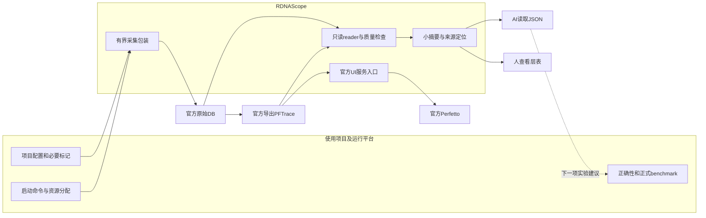

# RDNAScope薄工具主计划

版本：v1.0
日期：2026-11-12
定位：由使用项目自行配置、供人和AI共同使用的AMD RDNA执行观测工具。
状态：**T0–T3按本版限定范围完成；0.3.0a1本地alpha已构建并通过源码外wheel验收。远端发布不作为本地资格结论。**

本文件是薄产品的实施与验收主计划。它落实[ADR 0004](adr-0004-thin-tool-boundary.md)，取代旧路线中“工具内建完整模型测试与自动优化平台”的范围要求。旧版本、原始数据、未通过的测试及仓库内`docs/implementation.md`保留，不改写为已完成。

本文同时保留原始目标设计与完成状态；实际可用命令、配置和限制见[薄工具使用说明](thin-user-guide.md)，不要把尚未验证的未来能力当成当前alpha支持。

## 1. 产品目标

让一个项目通过自己的少量配置和必要标记，生成可核对的短trace与小摘要：

- 人能方便地查看scope/layer、rank与可见执行顺序。
- AI能读取同一证据，指出下一处值得检查的位置和一个区分实验。
- 正式性能测试可以关闭新增观测，诊断成本有边界、缺失有记录。
- 项目更换模型、引擎或运行命令，不要求向RDNAScope增加专用代码。

产品交付以观测是否可信、接入是否简单和下一项实验是否明确衡量，不以必须获得模型提速或支持所有RDNA能力衡量。

## 2. 四项核心职责

| 职责 | 最小交付 | 边界 |
|---|---|---|
| 采集 | 接收显式配置和命令，调用已验证的官方采集链路，记录退出、写库和缺失状态 | 不负责模型服务、GPU调度或优化实验编排 |
| 读取 | 只读读取官方原始文件和导出，提供有来源的有界查询 | 不创建另一套原生trace格式，不修改时间戳拼接全局时间线 |
| 摘要 | 按调用方提供的scope/layer/rank等字段生成JSON与简洁文本 | 不猜测模型结构，不自动把跨度解释为计算/搬运/等待 |
| 查看 | 启动或连接自有官方Trace Processor服务，给出官方UI与精确事件定位 | 不重建trace前端，不接管其他服务 |

围绕上述职责保留必要的身份、完整性、能力边界、输出预算和自有进程管理。其他功能只有在确有复用价值且不引入业务假设时再评估。

## 3. 范围与所有权

| 内容 | 所有者 |
|---|---|
| 官方采集/导出包装、native reader、通用摘要、官方UI入口 | RDNAScope |
| 最小run manifest、来源/单位/覆盖/时钟状态 | RDNAScope |
| 通用HIP、Graph、多rank小fixture及格式反例 | RDNAScope |
| 项目启动命令、容器/环境、GPU预约与集群调度 | 使用项目或机器平台 |
| layer/阶段/迭代标记、项目Graph读出时机、业务字段解释 | 使用项目 |
| prompt、模型输出oracle、精度、benchmark、A/A与A/B | 使用项目 |
| 编译缓存、模型权重、worktree、候选patch和采用判定 | 使用项目 |
| 项目优化skill与历史性能知识库 | 使用项目 |
| 原始trace、run日志与诊断报告 | 调用方显式选择的输出目录 |

**工具仓库不建立按项目命名的adapter、hook、配置模板或候选目录。** 把专用代码改放到内部plugins/examples不算解耦。仓库示例只用通用小workload，不复制真实项目接入。

首版不内建模型benchmark平台、自动代码优化、正式收益验收、全框架自动hook、常驻AI服务、全量实时仪表盘、跨集群调度或对象存储。PMC、PC sampling、操作系统调度追踪等也不作为第一版要求。

## 4. 首版能力范围

第一版只资格化少量可验证的设备/运行时/采集模式，不追求全面覆盖。初始开发环境复用当前锁定且已有证据的ROCm工具配对，机器路径、镜像、设备排除和预约政策留在外部配置与启动环境中。

支持矩阵至少区分：设备型号/gfx、驱动/ROCm/HIP、采集SDK、导出工具、eager/Graph、rank数、观测种类和实际验证范围。官方工具可运行不等于某一层耗时或跨rank时钟已资格化。

没有layer标记时，工具仍可读取和展示可见native事件；没有真实GPU层边界时，layer GPU耗时保持unknown。无GPU机器可以完成离线导入、查询、摘要和查看。

## 5. 目标架构



采集、离线读取和查看分别可用。查询/报告不隐式启动应用、GPU、下载或采集器。正式benchmark与诊断运行具有独立run身份，通过调用方提供的相同条件关联，不能拼成同一次请求的时间分解。

### 5.1 工具内部建议结构

```text
rdnascope/
  capture/       # 通用后端与官方导出包装
  readers/       # 只读native/官方导出读取
  report/        # scope/rank统计、覆盖和来源
  ui/            # 官方Trace Processor进程与UI定位
  contracts/     # 最小run/annotation/summary契约
  runtime/       # 仅本工具所需的预算与自有进程处理
  cli.py
tests/           # 通用正反例、小fixture
examples/        # 无应用专用接入的最小用例
docs/
```

这只是职责划分，不要求为了目录整齐重写已验证代码。能复用现有reader、来源校验和服务生命周期的部分优先复用。

### 5.2 使用项目侧建议结构

```text
consumer-project/
  .rdnascope.toml
  tools/profile_scopes.py     # 可选，由项目维护
  tools/run_workload.sh       # 项目自己的启动方式
  benchmark/                 # 项目自己的测试与验收
  traces/<run-id>/            # 原始大文件默认不入Git
```

工具不自动修改这些文件，不按已知模型名注入hook，也不解释项目内部HTTP或输出格式。需要接入逻辑时，在使用项目自己的独立改动中实现。

## 6. 用户操作路径与配置

### 6.1 最小操作路径

目标日常流程：

```text
项目准备环境/资源 → 配置采集 → 生成短trace
  → 查看scope/rank摘要 → 官方UI核对 → 项目选择下一项实验
```

已实现的首版命令示例；具体参数以[使用说明](thin-user-guide.md)为准：

```bash
rdnascope --config .rdnascope.toml doctor
rdnascope --config .rdnascope.toml record --output ./traces/run-001 -- ./tools/run_workload.sh
rdnascope query ./traces/run-001 --view coverage
rdnascope --config .rdnascope.toml report ./traces/run-001
rdnascope view ./traces/run-001 --port 9002 --idle-seconds 300
```

`doctor`只检查配置与工具身份；`record`才显式启动子命令与采集。`query/report`默认离线，`view`才启动官方服务。CLI迁移时明确旧命令的去向，不静默重解释参数。

### 6.2 最小配置契约

配置只描述工具、采集预算、输出和元数据。以下为字段设计示意，默认值与后端映射在T2冻结：

```toml
schema_version = 1

[tools]
rocprofv3 = "/path/to/rocprofv3"
rocpd_command = ["/path/to/python", "/path/to/rocpd"]
trace_processor = "/path/to/trace_processor_shell"

[capture]
backend = "rocm_native"
profile = "scope"
timeout_seconds = 120
max_output_bytes = 1073741824

[context]
id = "local-workload"
# annotations = "./trace-context.json"
```

示例预算不是完整模型所需空间估计，也不是所有机器的通用阈值。原始native采集可能包含启动期数据，显示窗口很小不代表采集落盘也很小。后端不支持某个profile时明确拒绝或返回unsupported，不能静默开全量采集。

相对路径以配置文件目录为基准；CLI显式参数优先。命令以argv传递，不隐式拼接shell。应用启动脚本自行处理容器、scheduler、rank和资源预约；工具核验实际可见环境及已提供的设备/rank信息，不把外部声明当已证明的资格。

## 7. 最小数据契约

首版围绕三种小文件组织，不要求每次登记完整实验、性能参考或知识库记录。

| 文件 | 内容 |
|---|---|
| `run-manifest.json` | 工具/后端身份、调用参数、调用方上下文、rank/PID/设备关联、状态、原始文件引用及SHA、预算与缺失 |
| `annotations.json`，可选 | 调用方提供的scope/阶段/迭代/layer/rank与原始事件或区间的关联及证明范围 |
| `summary.json`及`summary.md` | 同一事实的机器/人工表示：统计、覆盖、限制、证据位置和下一测量建议 |

原始DB、PFTrace和upstream日志保持官方格式，旁路元数据不复制为另一份伪原生trace。额外业务指标只接受声明的数值/单位/scope/来源，工具不硬编码其含义或正确性协议。

### 7.1 必须保留的状态

- 采集与导出分开：complete、incomplete、failed、unsupported、not_requested。
- 关联分级：exact、inferred、unmapped；未知值用null/unknown。
- 时间口径：CPU提交、GPU stream区间、native kernel分别标明，记录clock domain与有效精度。
- 覆盖仅相对于声明窗口：完整、部分、未知；writer完成不替代独立丢失检查。
- 分析结果标明diagnostic及扰动资格；命令退出0不代表模型正确、正常性能或完整覆盖通过。

rank、request、iteration和Graph ID保持各自语义。Graph replay不能自动称为全局token位置；不同provider的correlation ID不能因数值相同就合并。缺少时钟校准时保持每rank观察，不计算精确到达差或纯rank等待。

### 7.2 摘要最小输出

scope名与可选类型、rank、采样窗口、样本/缺测数、声明时间口径下的中位数与样本最大值、变异、覆盖状态、原始事件locator、工具build、限制及下一项区分实验。小样本不输出可靠生产P95声明。

JSON与Markdown由同一确定性结果生成。报告可指出异常位置，不自动认定根因或承诺可回收时间；输出数量受限，优先展示最值得检查的一项及其不确定性。

## 8. Layer级观测设计

### 8.1 三档用途

| 用途 | 范围 | 第一版政策 |
|---|---|---|
| off | 不开启新增标记/采集/GPU计时 | 正式benchmark的默认选择，由项目控制 |
| scope | 有界的项目标记与scope/rank摘要 | 日常首选；CPU标记只说明CPU口径，不保证真实GPU层时间 |
| native ROI | 为一个明确问题采短native窗口，核对Graph/kernel与依赖线索 | 按需升级，单独保留覆盖/输出/扰动结论 |

范围控制依赖实际后端能力和项目配合。不能因请求了layer粒度，就承诺自动从任意程序还原模型层。

### 8.2 Eager与Graph分别验证

Eager中Python/ROCTx范围通常首先反映主机提交；GPU执行需有独立边界或原生关联。Whole-model Graph replay绕过每次Python layer调用，capture时的主机范围不等于每次replay的层执行。

真实layer GPU摘要仅在以下证据之一成立后提供：

1. 官方原生Graph节点与调用方scope的映射已经按该环境/模式验证。
2. 调用方提供了已验证的GPU区间，并明确stream依赖、record generation、完成、读出和复用生命周期。

Event埋点如果捕获进Graph，即使降低读取频率也可能每次replay执行；这部分成本必须计入诊断条件。工具不为监控拆生产Graph、不新增逐层同步/barrier，也不偷偷切eager或改单卡后仍称原多卡生产场景。

无法证明时输出已知的scope/Graph整体或native事件，layer GPU耗时unknown。工具接受首版能力因此缩小。

### 8.3 下一优化目标如何产生

| 观察 | 下一项最小实验 | 不能直接下的结论 |
|---|---|---|
| 同条件某scope反复偏长 | 只对该scope补一个子阶段或独立fixture | 一定是某个kernel慢 |
| 某rank同位置区间反复偏长 | 核对同一操作序号及其前序依赖 | 差值就是通信等待 |
| 多个scope一起变慢 | 检查环境、供给和观测扰动 | 应逐个重写kernel |
| scope摘要相近、外部E2E差异大 | 检查未覆盖的准备/调度/输出阶段 | 未采区间为GPU idle |

AI可以在这些事实之上提出假设；应用优化skill与执行留在项目侧。没有关键路径证据，不用scope时间占比推算模型收益上限。

## 9. 性能影响与成本政策

第一版以**正式评分与独立诊断分开**保护测试。诊断与benchmark各有run_id，并保留共同条件指纹；不把不同run的层时间拼进某次HTTP wall。

默认不采完整调用栈、不启用高频计数器、不逐层打印/JSON序列化/落盘。必要记录采用预分配有界缓冲；分析、导出、哈希和查看尽量放在敏感测速之后。没有在异常前采到的GPU事件不能事后补采。

将来若要同开监控与正式测速，先预注册开/关对照、统计单位和停止条件。**≤1%增量开销是目标，不是已实现承诺。** 基线噪声无法分辨这一量级时返回inconclusive，继续分开运行；不扣除所谓trace成本，不删慢样本，不重跑筛到通过。

验证分别记录采集成本、应用CPU/RSS变化、GPU运行条件、数据体量和离线处理成本。数据小不意味着解析内存小，服务不使用GPU也可能与测试竞争CPU/内存/IO。没有匹配证据时不声称零扰动。

## 10. 产物与生命周期

每个run使用新目录，原始文件完成写入并校验后再查询。状态不完整时保留partial文件和原因，不覆盖为下一次成功。

| 类别 | 政策 |
|---|---|
| 官方DB/PFTrace/关键日志 | 在消费方目录保存；被引用的证据不自动删除 |
| 摘要/小查询缓存 | 按源SHA、工具/查询版本复用，受工具预算约束 |
| 模型/编译缓存/应用worktree | 不由RDNAScope管理、复制或回收 |
| 官方UI服务 | 显式keep或空闲退出；记录PID、初始输入、RSS/PSS，停止仅作用于自有服务 |

采集期有明确时间/输出预算。监测超限停止自有采集并保留失败记录；应用级监测可能在两次检查之间超出预算，不能称文件系统硬配额。只裁剪显示窗口不会缩小已保存原始DB，报告空间时分别计数。

首版不做跨项目全局raw registry、中央知识库或大规模自动GC。沿用的缓存清理默认预览，外部原始数据与未纳管目录不进入工具删除范围。

## 11. 现有实现迁移清单

| 当前部分 | 目标动作 |
|---|---|
| `bridges/`中的应用专用桥及相关bootstrap测试 | 外移到使用项目；不进入新wheel/sdist/示例 |
| 应用特有benchmark parser、adapter枚举、HTTP结果解释 | 随业务协议外移；不改名后继续藏在通用层 |
| `benchmark.py`、`experiments.py`的模型/候选编排 | 从薄产品默认API移出；保存在外部项目或旧版本环境 |
| `workloads.py`中的业务执行流程 | 外移；仅按需复用通用capture子进程机制 |
| `records.py`、reference/knowledge/大规模semantic流程 | 缩到run来源与摘要所需；不要求用户每次使用完整实验系统 |
| `namespaces.py`及编译缓存编排 | 移出应用编译缓存职责；工具自身派生缓存另行限额 |
| `providers.py`、`query.py`、部分`storage.py` | 优先复用native只读/来源/查询逻辑，减少与业务格式的依赖 |
| `capabilities.py`与质量检查 | 保留与采集/格式/时钟/覆盖直接有关的部分 |
| `services.py`、`ui.py`及必要worker | 复用官方UI和精确定位，裁去无关实验编排 |
| 旧`tlp`入口与历史schema | 旧环境/版本明确保留，不使新工具必须安装原型 |
| 文档/示例/skill/CI | 主路径改为通用观测；无逐项目接入，保留明确的历史版本说明 |

不能通过取消错误检查、只删除测试或将未通过项隐藏来缩小工具。迁移前后都核对原始文件与外部资源状态。

## 12. 历史保留与回退

T0已在工具仓库之外保存当前本地公开文件快照及SHA清单，覆盖公开tag之后尚未发布的本地修复。公开旧tag不能替代这份较新源码快照。

T1移除路径之前：

1. 列出引用该路径的旧run、helper、schema与验证程序。
2. 在外部档案中保留所需源码/测试/版本身份，建立明确的新source binding或可用性映射。
3. 在隔离环境验证旧证据仍可按其原版本读取；不拿新schema静默改写旧记录。
4. 无法保留旧路径时，标记原路径不可用及档案位置，禁止假装旧字节仍在那里。
5. 保存回退说明，之后才移除新发行包中的业务代码/API。

回退恢复的是对应工具版本与接入配置，不恢复或改写被测项目已接受基线。原模型、原始数据、旧缓存和外来服务保持原所有权；迁移不是数据清理授权。

## 13. 分阶段执行计划

| 阶段 | 产物 | 依赖 | 当前状态 |
|---|---|---|---|
| T0：范围与盘点 | ADR、耦合清单、仓库外快照、主计划 | 用户范围决定 | 范围/盘点已完成；本文件为完整执行基准 |
| T1：业务接入外移 | 外部接入/解析/测试、引用映射与回退 | T0 | 完成；旧版本独立核验与本地可回退提交 |
| T2：最小通用产品 | 通用配置/record/query/report/view、最小契约、瘦发行包 | T1形成可回退边界 | 完成；CPU、官方PFTrace/UI与源码外wheel通过 |
| T3：工具资格与外部使用 | CPU、最低GPU、外部消费、开销/文档/打包报告 | T2及实际资源 | 限定范围完成；合成GPU/外部使用通过，成本inconclusive |

### T1任务

- [x] T1.1 冻结迁移基线，核对T0快照与后续源码差异。
- [x] T1.2 在消费方独立目录/改动中接管专用桥、业务解析、配置、测试与skill调用。
- [x] T1.3 建立历史引用映射，验证旧环境不依赖即将移除的实时源码路径。
- [x] T1.4 从新包及schema移除应用专用分支；通用代码不再解释业务HTTP/输出协议。
- [x] T1.5 运行对应CPU与源码外安装验证，提交可单独审核、可回退的变更。最终wheel、CPU与本地分支提交完成；远端未作为本项条件。

T1完成标准：新工具不需要任何真实应用仓库才能安装；项目接入不再随新包分发；旧证据的可用性和外部测试职责有明确记录。

### T2任务

- [x] T2.1 冻结最小配置、manifest、annotation、summary及CLI错误/状态语义。
- [x] T2.2 复用通用reader/查询，支持直接读取显式run目录，保留源文件与单位验证。
- [x] T2.3 实现项目命令的有界采集与官方导出包装，后端差异放工具能力配置。实际GPU官方采集属T3资格。
- [x] T2.4 实现确定性的scope/rank摘要；缺标记/缺覆盖/未知时钟有明确降级。
- [x] T2.5 接通官方UI、精确locator和VS Code端口说明，不新增前端。
- [x] T2.6 裁减默认benchmark/候选/知识库/编译缓存编排及相应分发资源。
- [x] T2.7 更新配置/使用文档、通用观测skill、测试与兼容迁移说明。

T2完成标准：CPU环境可从独立目录安装并走通离线读取→摘要→查看准备；显式采集路径不依赖已知应用名、模型目录或私有helper。

### T3任务

- [x] T3.1 CPU正反例、安装/依赖与包内容审核。6项工具测试、3项消费方隔离测试、源码外CLI/`pip check`及包字节审核通过。
- [x] T3.2 单GPU eager最低数值/事件/采集与导出守恒检查。物理4合成fixture，16/16；见原工程步骤112。
- [x] T3.3 Graph动态输入、replay覆盖及实际时间口径验证。五值、五launch窗口、19/19；仅fixture Graph边界，见步骤112。
- [x] T3.4 双rank小fixture输出、rank映射、清理与缺失检查；时钟未校准则不量化等待。物理5/6、66/66，writer/loss仍unknown，见步骤112。
- [x] T3.5 在一个外部项目仅增加其自己的配置/标记完成使用，工具仓库不加应用文件。外部合成消费方CLI/CPU scope/UI，见步骤113。
- [x] T3.6 用另一通用workload检查无需修改工具源码即可复用；不宣称全框架支持。历史Graph标量乘PFTrace离线192 kernel，见步骤113。
- [x] T3.7 核对采样/关闭条件、实际开销与数据预算；不可辨识则明确diagnostic/inconclusive。7×3样本噪声大，约167MB原DB/21MB导出，见步骤113。
- [x] T3.8 更新支持矩阵、发布说明、独立wheel验收与失败记录后再形成新alpha。本地`0.3.0a1` wheel/sdist及回退/失败说明已形成；未把远端状态写成通过。

GPU工作开始前重新核对资源/环境，不把历史卡号当当前分配；无资源时交付已完成的CPU/文档部分并保留硬件待验项。执行按阶段验收推进，不虚构固定工期或无限等待资源。

## 14. 验证矩阵

| 类别 | 必须验证的行为 |
|---|---|
| 便携性 | 干净环境/源码外CWD安装，无模型仓库、原型路径或重型框架隐式依赖 |
| 包边界 | wheel、sdist、schema、示例与runtime入口不含应用专用接入；只扫名称不足以证明语义解耦 |
| reader | 原始格式只读、整数时间/单位正确、输入改变可发现、相关导出不重复计数 |
| 采集 | 超时、退出非零、writer未完成、丢失未知、截断DB/活跃WAL均明确失败或降级 |
| scope | 缺少标记、嵌套、重叠、单位不同和混合run不生成伪预算 |
| Graph | capture与replay区分、动态输入、节点/边界覆盖及记录复用有效 |
| 多rank | rank/PID/device关联有来源；缺rank拒绝完整声明，未知时钟不算到达差 |
| 生命周期 | 预算不足、取消、失败、端口占用只处理自有对象；原始失败数据保留 |
| 复用 | 等价查询复用小派生物，应用原始数据不复制进工具仓库 |
| 人机一致 | JSON/Markdown统计一致，官方UI locator绑定同一输入和工具build |
| 成本 | 采集/应用/离线处理分开记录，关探针与短诊断的输出行为有证据 |

迁移后的测试数不以维持旧数量为目标：应用测试移至消费方，通用风险测试保留。硬件资格不能由CPU测试数替代。

## 15. 发布策略

新薄产品使用与现有宽alpha明确区分的版本，具体版本号在实施发布时固定。当前Apache-2.0许可保持；不重新分发模型、工具镜像、完整trace或私有接入数据。

发布前检查：依赖、可用命令、配置/schema版本、与旧API的差异、支持矩阵、已知限制、通用示例、CPU/最低GPU证据和独立wheel结果。raw数据不必公开，但公开摘要必须准确说明验证环境与范围。

旧版本保留可用安装/档案说明；不以一次自动迁移更改用户原始文件。发布不以解决某个模型瓶颈或采用一个候选为条件。本计划文本不触发提交、推送或发布。

## 16. 主要风险与处理

| 风险 | 处理 |
|---|---|
| 工具再次长成应用平台 | 新功能检查是否能脱离业务语义复用；专用功能留在消费方 |
| 只有格式完整，解释却错误 | 时间/覆盖/时钟/关联独立分级，unknown不升级 |
| Graph层级看起来存在但不是实际重放 | 验证真实GPU边界；失败就缩小范围，不靠Python hook补齐 |
| 监控改变性能 | 默认分离诊断与评分，记录开销和队列/同步变化 |
| 业务外移后旧case失效 | 先保留源码和旧环境，再外部绑定或显式报告不可用 |
| 工具升级/SDK导出差异 | 记录build与环境，使用匹配正反例重验；workaround不无条件套用所有版本 |
| 产物持续增长 | 每项目显式输出、有限采集、派生复用；原始证据保留政策由owner制定 |
| “没有代码分支”却仍硬编码业务格式 | 检查字段语义、schema及测试契约，不只搜索项目名称 |

## 17. 最终完成标准

- [x] 新包无需特定应用或旧原型目录即可安装。
- [x] 任意接入代码、业务协议与优化执行均不在工具仓库维护。
- [x] 一个消费方通过自己的配置和必要标记完成短采集→摘要→官方查看。
- [x] 第二个通用workload不需要新增应用分支，未知能力明确降级。
- [x] 原始数据保持官方格式，来源/事件locator/覆盖和失败可追溯。
- [x] 人和AI使用同一份摘要，至少得到一项有证据的位置观察与下一测量建议。
- [x] 正式评分和诊断条件明确，未验证时不承诺零开销或模型收益。
- [x] 产物/进程有界，历史证据、应用基线和外部资源不被误改。
- [x] 新alpha的CPU、适用最低GPU和源码外wheel验证完成，发布范围准确。

完成这些条件即可交付一把可用的薄工具。完整模型层分解、全硬件覆盖和自动优化不作为本版隐含后续义务。

## 18. 执行记录与文档优先级

后续每项实施记录任务ID、改动位置、实际命令、结果/失败、证据路径、限制和下一项前提。功能变更运行相应CPU测试；打包/资源变更验证源码外安装；GPU动作有独立当前环境和实际结果。

优先级：用户后续指令 → 本主计划与[ADR 0004](adr-0004-thin-tool-boundary.md) → 仓库内`docs/implementation.md`与[薄工具支持矩阵](thin-support.md) → 历史`docs/roadmap.md`。范围决定约束未来实施，实现记录反映当前事实，两者不能互相冒充。

旧的大计划和layer设计保留为来源，已被收缩的职责不再默认扩建。实际接入验证的项目记录留在消费方，RDNAScope只保留通用结论、能力证据与接口文档。
