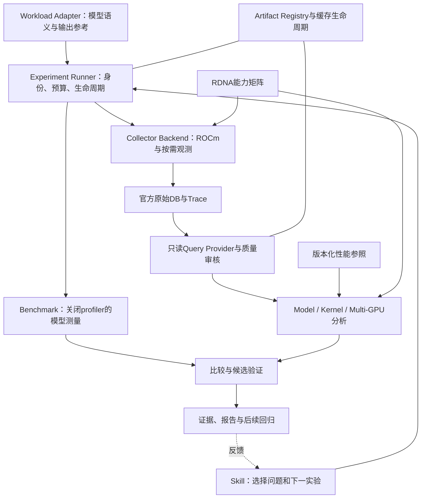

# RDNAScope 长期性能诊断与优化工具改进计划

> 2026-11-12范围收缩：后续以[薄工具主计划](rdnascope_thin_tool_master_plan_20261112.md)和[ADR 0004](adr-0004-thin-tool-boundary.md)为准，聚焦通用采集/查询/摘要/官方查看。项目接入及优化工作流由使用方持有。下列R0–R6保留为历史路线与验收记录，不再全部作为薄工具必须承载的产品范围；移出工作尚未实施。

> Planning snapshot from the original prototype. Current checkpoint: 0.2.0a1 software alpha; R0–R2 locally validated and R3–R6 software/evidence interfaces implemented. Fresh R3–R6 GPU/model/second-pair acceptance remains resource-blocked. Actual results are recorded in [implementation.md](implementation.md) and [R3–R6 validation](validation-r3r6.md). The design below retains its original historical wording.

版本：计划草案 v1，2026-11-11。目标仓库：[zihaomu/RDNAScope](https://github.com/zihaomu/RDNAScope)。

本文件用于下一阶段工程实施与验收。以下目标目录、接口、命令和里程碑均为拟议设计，不代表已经实现。本轮只编写计划及核对现状，没有初始化或迁移 Git 仓库、执行功能改造、清理缓存、启动 GPU、提交或推送。

## 1. 项目定位与长期目标

RDNAScope 定位为：**面向 AMD RDNA 的模型、kernel 与多卡性能诊断和优化验证工具。**

面向长期使用，需要稳定回答三个层次的问题：

| 层次 | 主要问题 | 必要输出 |
|---|---|---|
| Model | 一次请求或服务负载为什么慢？prefill、decode、CPU准备、offload、排队分别如何影响关键路径？ | 测速口径、阶段/依赖证据、可比较基线、已解释部分与未知部分 |
| Kernel | 实际 kernel 相对该 GPU、dtype、shape、布局下的可达性能差在哪里？ | 实际耗时、参照范围、可用硬件指标、可能约束与验证实验 |
| Multi-GPU | TP/EP 等并行为什么没有达到合理扩展效率？ | 同负载扩展参照、拓扑/通信条件、rank关联、计算与通信重叠及等待的证据 |

长期优化工作方式：

```text
定义性能问题与参照 → 稳定测量/检查可辨识程度
  → 按需短窗诊断 → 一个机制假设 → 一个隔离候选
  → 对应的正确性/子链路验证 → 关闭profiler的模型对照
  → 保留、回退或inconclusive → 归档与后续回归
```

诊断、基准测量和候选实验应能独立使用。用户无需启用自动修改代码，也能获得可追溯的分析；自动改写 kernel 不作为首版交付前提。

首个完整适配场景为 **R9700/gfx1201＋当前锁定 ROCm 10.1 环境＋FreeToken＋Qwen3.8 Flash Next＋TP1/TP2**。随后用第二个轻量 workload adapter、另一种实际设备组合验证接口泛化。尚未实测的 RDNA 型号和功能保持未验证，不由首场景推断支持。

## 2. 当前起点与必须保留的边界

### 2.1 已有组件

- 原始输入、工具和源码身份记录，HTTP输出参考校验，GPU预约/占用检测、超时和自有资源清理。
- rocprofv3 → rocpd → 官方 PFTrace 导出 → 原始DB/导出事件守恒审核 → 官方 Trace Processor/Perfetto UI；本机场景已验证 QUEUE 模式。
- Chrome/Macro/HTTP离线导入、质量分级和受限分析；符合条件的Chrome native输入进入当前TraceLens后端。
- 隔离worktree、fixture、模型A/A与ABBA筛选入口、decision及本地证据知识库。

### 2.2 当前限制

| 项目 | 当前事实 | 本计划要求 |
|---|---|---|
| 采集资格 | 官方03的36/36输出匹配，8936 kernel区间逐条守恒；ROI为每rank两个decode Graph | 保持该资格范围，不能称为完整模型覆盖 |
| 测速 | 已归档三启动A/A的三个case漂移49.82%/28.61%/7.67% | 建立可辨识效果的测量协议；不宣称已有正常性能验收 |
| 优化器 | 仅一个RowGather候选；局部fixture通过、局部稳定性失败，模型AB未执行 | 将候选类型与对应验证门分开；不把已接线写成已实测 |
| 分析通路 | 新PFTrace未直接接入现有TraceLens入口，通用报告尚非自动关键路径分析 | 统一身份与查询结果，不重新手写一套原生trace格式 |
| RDNA支持 | 已有部分R9700 synthetic及特定模型ROI资格 | 逐设备/运行时/后端/模式记录能力与证据 |
| 存储 | 新run、详细CSV、多个导出、worktree与部分编译缓存会累计 | 建立可查询、可复用、有预算的生命周期 |
| 可迁移性 | 模型/工具/镜像/预约路径、源码根目录及机器规则仍有硬编码 | 从通用代码移入用户或场景配置 |

当前目录尚无Git仓库元数据；2026-11-11只读查看目标GitHub页面显示为空仓库。首次迁移需选择发布内容并建立可安装工程，不能默认当前目录全部适合入库。现有`pyproject.toml`中的0.1.0是原型包版本，不作为RDNAScope已发布版本的证据。

历史AA失败、截断DB、默认STREAM区间错误、公开API覆盖盲区等均保留。此前的2%/5%/1.10等门槛属于具体实验，不能成为所有RDNA任务的通用默认值。

## 3. 长期架构与仓库边界

### 3.1 核心职责



职责边界：

- Core管理身份、质量、预算、存储引用和报告契约；不导入FreeToken或假定固定两张卡。
- Workload adapter提供启动/关闭、请求协议、prefill/decode语义、输出参考和可选Graph/层映射。
- Collector/exporter封装官方工具及其已验证配置；保留官方原始数据。
- Query provider统一只读查询能力和小型结果集，支持rocpd、Perfetto、HTTP和历史输入。
- 分析模块消费查询结果及能力/参照，输出证据和限制；不直接控制资源或修改模型。
- Benchmark与Experiment分别负责测量和候选验证；Skill通过稳定CLI调用它们，核心判定不依赖LLM服务。

### 3.2 建议目标目录

以下为迁移后的目标布局，具体文件在实施PR中拆分：

```text
RDNAScope/
  pyproject.toml
  README.md / README.zh-CN.md
  src/rdnascope/
    core/             # identity、schema、quality、paths
    storage/          # artifact registry、cache、retention
    backends/         # rocprofv3、rocpd、Perfetto、TraceLens
    workloads/        # adapter接口、FreeToken、轻量示例
    benchmark/        # 测速合同、AA、比较
    references/       # 参照检索与有效性判断
    analysis/         # model、kernel、multigpu
    experiments/      # 隔离候选及类型化验证
    cli.py
  schemas/v1/
  profiles/           # 可移植示例；不含个人机器配置
  sql/                # 带版本和能力要求的查询
  skills/rdnascope/
  tests/fixtures/     # 小型、可公开、来源明确的正反例
  docs/               # quickstart、架构、能力、协议、迁移和路线图
  .github/workflows/
```

发布核心包无需Torch、FreeToken、ROCm、浏览器或模型权重。GPU采集、TraceLens及浏览器验证作为可选能力，`doctor`逐项报告。安装到任意目录后仍应工作，不能通过源码`parents[2]`猜测用户数据根目录；包内资源与用户数据路径分开。

核心安装和离线示例不隐式下载Torch/ROCm/浏览器、不启动GPU任务。可选工具的获取、版本校验与离线使用方式单独说明。

原`tlp`命令在文档化的过渡版本保留兼容入口。新增`rdnascope`包/命令前先明确对应关系、弃用提示和读旧数据的方式；历史结果不因包更名失效。

## 4. 优先补齐一：统一实验身份与只读查询

### 4.1 身份与语义契约

| 身份/对象 | 最少需要记录的内容 |
|---|---|
| Experiment | 问题、目标指标、停止条件、计划、资源/时间预算 |
| Run/Attempt | 单次执行与角色、父实验、独立重试ID、完整/失败状态；失败记录不覆写 |
| Workload | 模型revision、输入集/输出参考、token口径、并发、TP/EP/Graph、cache/线程配置 |
| Environment | 代码/patch/native、Python/Torch/Triton/SDK/编译器、镜像或安装环境身份 |
| Device/Rank | 设备型号/gfx/UUID/PCI、当前ordinal映射、并行组与rank、拓扑和资源所有权 |
| Semantic position | request、phase、token/chunk、layer/op、Graph实例/replay/slot；不可得则unknown |
| Artifact/Query/Reference | 实际SHA、格式/版本、生成工具/选项、来源依赖、SQL/分析版本及参照ID |
| Clock | 原始单位/时钟域、转换方法、误差及资格；不以同机或官方合并替代跨rank时钟验证 |

必须区分：

- request/token/Graph/dispatch不是同一种ID；Graph可重放，算子与kernel也可能多对多。
- 数据关联分别标记`exact / inferred / unmapped`，推断映射不升级为精确覆盖。
- shape、dtype、布局和计算量需来自明确元数据或已审核的计算规则，不从kernel名称猜出完整语义。
- 永久引用需包含artifact与backend版本。Perfetto的临时slice ID不能脱离指定输入和工具版本当全局事件ID。
- 保留原始时间；统一单位时记录变换。纳秒整数跨语言传递应保留精度，不由浮点或JS数字精度改变事件。

### 4.2 统一查询接口

实现按能力发现的只读接口，例如`events / phases / kernels / collectives / metrics / coverage / provenance`。这是接口草案，不是当前已存在的CLI/API。

- rocpd通过只读SQLite查询，PFTrace通过官方Trace Processor SQL查询，历史Chrome/Macro和HTTP保留各自reader。
- 同一套指标/语义定义服务Model、Kernel和Multi-GPU报告；TraceLens作为可选分析provider接入，不强制所有输入转成Chrome JSON。
- 默认聚合与分页；逐kernel明细CSV只在明确请求时生成，避免每次分析重复写大表。
- 查询结果带输入SHA、provider/tool/query版本、覆盖位置、时间口径、关联/时钟资格和限制。
- 只读约束针对原始证据；provider可在独立内存/临时工作区建立分析表和视图，不能修改输入DB。
- schema版本化：旧reader和旧case可读，迁移生成新派生物；不修改原DB或旧证据SHA。

验收：同一组已资格输入经不同provider得到的相同口径结果一致；缺token映射、丢rank、未知时钟等反例正确降级；所有finding均能回到原始输入和可重跑查询。

## 5. 优先补齐二：建立性能缺口参照

### 5.1 模型参照与测速协议

- 明确定义HTTP总耗时、严格TTFT、first-text、TPOT/ITL、服务端decode速率和服务吞吐。没有逐token时间时不输出ITL，没有首token证据时不把first-text改名TTFT。
- 单请求延迟、并发服务吞吐、冷启动、稳态生成分别建协议；warmup、输入长度、输出长度、并发、完成/失败请求与统计窗口全部明确。
- 先检查同条件A/A及可辨识效果，再做候选A/B。预先确定统计单位、配对/顺序、重复与启动次数、效果目标、护栏和停止条件，保留长尾与失败请求。
- 多次request或Graph replay可能相关，不能把同一启动内大量token当独立样本；少量样本不用于宣称可靠P95或噪声分布。
- 对照配置相等项与有意改变项分开。候选代码/配置改变不能因identity不同被一概拒绝，也不能忽略无意的环境变化。
- 无profiler测量仍需必要资源保护。可选observer的开销另做资格，不能从latency扣除KFD等报告计数。

### 5.2 Kernel参照

`device/gfx + runtime/compiler + dtype + shape + layout + workload conditions`共同定义参照适用范围。

区分三类参照：公开规格上界、设备上已校准的可达性能、同条件原实现。只有计算量、字节口径、计时与必要硬件指标合格时，才计算对应效率/roofline；逻辑payload与物理流量分别呈现。量化、解码、融合和FMA等计数约定需显式记录。

无足够元数据时可以报告kernel名称、次数、区间和局部对照，计算/带宽约束保持unknown。kernel累计占比不等于关键路径占比；只有建立了有效依赖和时间预算后才估算模型可回收上限。

### 5.3 多卡参照

- 在同一工作负载语义下比较TP1/TP2或其他并行度；同时记录总/每rank cache容量、线程、量化、算法和Graph差异。
- 理想线性扩展仅作为带假设的上界，不能自动作为该模型应该达到的速度。
- 通信参照匹配卡对/拓扑、collective类型/序号/并行组、dtype、payload及并发条件；不从“支持peer”推断实际直连路径或纯传输带宽。
- collective区间可能包含同伴晚到和依赖等待。跨rank量化需要同request/token/collective关联与足够精度的时钟证据；误差高于所研究差异时降级。

### 5.4 参照库生命周期

每条reference保存适用指纹、协议、样本、统计与误差、来源、质量、创建时间及重验条件。驱动/SDK/编译器、GPU型号或计时方式变化时重新判断适用性；旧参照作为历史证据保留。旧实验的2%、5%等阈值不升级为全局默认门。

验收：同条件比较可复现；不匹配条件被逐项指出；未知shape不生成伪roofline；无时钟资格不生成伪rank等待预算；数据不稳定时返回`inconclusive`并解释原因，不能重试到通过。

## 6. 优先补齐三：RDNA能力矩阵与采集资格

### 6.1 能力矩阵维度

按设备/gfx、SKU与内存、OS/驱动、ROCm与HIP组件、采集/导出工具build、框架/编译器、eager/capture/replay、单/多rank及具体功能记录。

功能包括：CPU API、ROCTx、kernel dispatch、copy、Graph覆盖、CPU/GPU关联、跨rank时钟、PMC/带宽指标、PC sampling及必要的分析元数据。后几项首先探测和验证，不承诺当前Radeon设备普遍支持，也不套用Instinct的指标或计数器含义。

状态至少区分`not_tested / qualified / conditional / failed / unsupported`；每项记录证据、限制和触发重验的环境变化。仅工具存在或CPU测试通过不代表GPU功能合格。

### 6.2 首个R9700 profile

- 保留当前ROCm10.1、HIP7.16及Torch/Triton/native配对身份；HIP组件版本不要求等于ROCm发行版本号。
- 应用、采集和离线导出环境分别描述。当前导出使用同镜像已有系统Python3.12绑定、应用仍为Python3.13的做法，记录为已验证profile，避免改模型依赖解决工具问题。
- 将本机排除设备、共享预约路径、镜像、SDK、模型与源码路径移出通用代码。每次运行动态核对PCI/UUID/ordinal及当前占用；本机限制留在本机profile。
- 默认STREAM区间错误、QUEUE选项和rank退出写库的教训进入工具兼容记录。升级后用守恒反例重验，不能把某个版本的workaround永久套到全部工具版本。

### 6.3 分层资格

CPU离线解析 → 小型eager数值/事件正向对照 → 真实Graph replay覆盖 → 单rank ROI → 多rank ROI与关联 → 特定模型覆盖/扰动 → 对应性能比较资格。

原始trace导出完成后，核对真实落盘、数据丢失、kernel名字/起点/时长、依赖事件、rank/设备对应及输出。父进程退出前后必须等待自有writer完成；超时或buffer丢失保留失败，不把部分文件标成完整采集。

采集器改变队列ring、priority/CU-mask等上下文的警告也要进入采集记录和扰动判断。区间守恒通过不代表队列上下文、正常性能或完整模型覆盖自动通过。

采集与导出要有时间、ROI/事件、内存/缓冲、磁盘预算。优先窗口化和结束后导出；SDK不支持某项限额时明确记录替代约束，不能虚报已强制执行。默认缓冲配置与实际RSS分开报告，不能把1GiB配置或3MB短窗文件当实际内存/完整请求容量。

验收：无GPU机器能使用离线功能；不支持的能力有原因与可用降级；缺rank、Graph部分覆盖、区间错配、未完成写库和采集扰动反例均被拒绝或降级，原始失败可追溯。

## 7. 优先补齐四：缓存、产物与服务生命周期

### 7.1 分类与保留原则

| 类别 | 内容 | 原则 |
|---|---|---|
| 原始证据 | rocpd/原始trace、HTTP/输出参考、身份/命令/关键日志 | 不可变；被case、报告或明确标记引用后默认保护 |
| 可再生派生物 | PFTrace显示窗口、摘要、详细CSV、符号化与部分截图 | 依赖和生成工具可追踪；按需产生、可复用，未引用者可按策略回收 |
| 编译缓存 | Triton/TVM/Torch/JIT等 | 按兼容指纹复用，不因新run无条件复制；不跨ABI盲用 |
| 临时工作区 | job scratch、中间查询、未固定的临时文件 | 生命周期有界，成功/失败/取消路径都记录清理 |
| 候选源码 | worktree、patch、源码manifest | 有owner和引用关系；保留未决/被引用候选，不能直接按目录年龄删除 |
| 服务内存 | Trace Processor/解析worker | 展示已载入trace、PID/owner、内存口径及空闲策略；可明确停止 |
| 外部用户数据 | 原FreeToken数据、模型权重及用户指定只读源 | 不进入自动GC，不复制模型权重作为trace缓存 |

失败不等于垃圾：用于解释问题的失败证据可以固定。无需将每次失败的所有大副本永久保留；由引用和显式保留策略决定，删除留下tombstone和原SHA，不能让校验器假装原始字节仍可读取。

### 7.2 Artifact Registry与复用

- 建立本机registry：artifact实际SHA、大小/类型、来源依赖、工具/参数、引用、owner、保留状态和位置。
- 默认单机文件存储＋可重建SQLite索引，暂不要求对象存储、向量数据库或常驻集群服务。
- 等价派生请求按输入SHA、工具build、查询/选项、schema/分析版本查缓存；一个原始采集优先保留一个完整合格导出，显示窗口按需复用。
- 内容哈希用于去重和不可变对象引用，清单/别名不复制大文件。同一转换工具重导出的二进制不一定字节一致；新SHA形成新对象，不能覆盖旧证据冒充相同输出。
- 同一源数据重复分析，应复用已有派生物；新的run身份/日志允许增长，但必须受保留与容量策略约束。
- 存储统计区分本run独有、共享、证据、派生、编译缓存及实际物理占用；共享对象/硬链接不按每个run重复计费。磁盘大小、进程RSS/PSS与GPU内存单独呈现。

### 7.3 编译缓存与测量公平性

共享namespace至少绑定gfx、Python ABI、精确框架/编译器、SDK、native/source/codegen输入及编译参数。使用后端实际支持的并发写入协议；必要时scratch构建、锁保护及原子发布，避免两个job损坏共享cache。

冷/热cache是实验条件。候选A/B采用匹配的预热/复用协议并记录命中情况；冷启动实验用独立namespace，不在对照中途清共享缓存。ABI或codegen条件变化时创建新namespace并重建必要native，不直接复用旧结果。

### 7.4 回收与预算

- 初始默认只输出GC预览；实际回收由显式命令或用户启用的策略执行，显示预计对象、大小、原因和影响引用。
- 引用中的证据、正在运行的job/service、持有lease的cache、未决/dirty worktree和外部源均受保护。
- 依据用户配置的容量、TTL与LRU回收未固定且可再生的对象；不足时报告预算阻塞，不静默删证据或丢弃trace事件。
- 回收需验证受管root、owner、引用及并发状态；不跟随符号链接删除到用户模型/原始数据目录，不对任意路径执行递归清理。
- 存储检查、预留空间及采集期监测从第一版实施。阈值按机器profile显式配置，本文件不虚构全机通用GB上限。
- 导出和大表默认置于HTTP队列结束后；默认只产摘要，明细按需。采集器自己的分配/导出活动应单独记录，避免混成模型业务开销。

### 7.5 服务与内存

解析worker按输入与任务隔离或有明确复用上限；提供服务列表、状态、停止及空闲超时。官方UI/Trace Processor继续复用，不让每次分析都启动永久不退出的新解析器。用户明确要求保留的服务可选择不超时。

重复加载/分析的小规模测试需检查内存是否在任务结束或worker退出后归还，以及长期复用时是否达到受控平台；不能只看文件3MB就推断解析内存3MB。浏览器仅为可选查看/测试依赖，不成为每次benchmark的后台负担。

验收：相同输入重复分析不增加等价大文件副本；兼容编译缓存可复用且错误ABI被拒绝；GC预览可解释，active/pinned/external对象不被删；预算不足停止新增高开销任务并保留已有证据；CLI能解释“哪些数据占用空间、谁在用、能否回收”。

## 8. 三类诊断与优化验证的交付方式

### 8.1 报告契约

每个finding包含：观察事实、问题/阶段/位置、参照及匹配条件、事件/查询证据、覆盖/时钟/能力限制、替代解释、下一项区分实验。数值性能缺口、可回收关键路径上限与最终收益分开；无足够证据时为空或unknown。

- Model报告以阶段和依赖为中心，记录已解释范围及未观测/未闭合残差，不将多stream/rank时间求和当wall。
- Kernel报告按实际实例及分组呈现时长/条件/参照；缺counter时保留描述性分析，不生成未经证明的带宽或算力结论。
- Multi-GPU报告区分逻辑负载差、等待线索、可验证到达差、传输参照和重叠；不把collective全部解释成传输。

### 8.2 候选类型化

| 候选类型 | 资格与实验 |
|---|---|
| Kernel/布局 | 独立数值参考、真实shape/stride/dtype、eager/Graph和必要stream依赖、局部A/A及计时 |
| Cache/offload/搬运 | 实际miss/布局/字节与依赖、生命周期、对应子链路对照及输出；不强制RowGather fixture |
| 线程/调度/配置 | 有意变更项与同条件控制、CPU/内存/输出护栏、对应假设的观察 |
| 并行/拓扑 | 模型语义、总/每rank资源差异、实际卡对/通信路径、匹配负载与扩展参照 |

精度协议随变更风险及工作负载合同确定，不将本项目历史688位置等规则变成所有任务的固定门。隔离候选、显式时间/卡数预算、不自动重试到通过、失败保留、可回退和自有资源清理继续作为runner责任。

最终效果由关闭profiler后的匹配模型对照判断。筛选通过不自动等于正式采用；`diagnostic / hypothesis / inconclusive / rejected / validated`与源码是否采用分别记录。禁止把被跳过的模型AB写成已验证。

### 8.3 Skill与稳定命令

拟议CLI围绕`doctor、inspect/query、capture、bench、analyze/compare、reference、capabilities、storage/cache、ui、experiment、kb`分组，实际名称在接口ADR中确定。

Skill只负责任务选择、读取证据、形成假设和调用这些受控接口。CI和命令行在没有Agent/模型服务时也能重放查询、核对输出与复现比较；工具输出采用版本化结构，避免Agent依赖终端自然语言猜状态。

## 9. GitHub迁移、协作与长期维护

### 9.1 首次入库范围

| 纳入仓库 | 默认留在本机/独立证据存储 |
|---|---|
| 源码、测试、schema/SQL、可移植profile示例、skill、文档 | 模型权重、原始tensor、完整trace/DB、运行日志与大型CSV |
| 小型正反例fixture及来源/授权/生成说明 | `.venv`、工具下载、浏览器、编译cache、镜像层 |
| 通用构建/依赖描述、工具版本获取与校验规则 | 个人路径、当前GPU预约/占用、PID、socket、机器私有配置 |
| 公开支持矩阵、可分享的摘要与证据索引 | 默认包含prompt/响应或本机路径的完整私有实验包 |

现有`.gitignore`已排除部分目录，但首次迁移仍需检查实际候选文件清单，不能直接`git add .`。现有`.so`、机器锁、旧案例和文档按“源码/必要示例/本机配置/历史证据”逐项分类；旧证据链接外置后仍保留原SHA及可用性状态，不把GitHub上不存在的`artifacts/`链接宣称为可复现公开证据。

首次实施在新的RDNAScope工作目录建立目标仓库checkout，按清单迁移可发布内容；保留原型工作目录作为历史来源，不移动其原始证据、不因更名中断已有服务。验证新目录后再切换日常开发；旧数据可通过只读binding关联。

分享bundle由显式导出生成，默认使用匿名标识或哈希，按选择携带输入/输出；原始私有数据保持不变。变换后的bundle拥有新身份与说明，不能冒充原始采集。

### 9.2 工程要求

- 核心包可从干净checkout构建和安装，在非仓库CWD运行离线示例，不依赖特定个人目录或另一个项目目录。
- 配置优先级、数据/cache根目录、机器profile和来源binding有文档；源码不包含本机禁用卡号、固定模型和共享预约路径。
- 依赖分组及兼容范围清晰：核心、Perfetto、TraceLens、采集、特定workload、开发测试分别声明。分析工具与应用环境隔离，升级按矩阵重验。
- 仓库owner明确项目许可证；保留第三方声明并记录上游组件的获取/校验与再分发方式，不默认把浏览器、ROCm工具或现有wheel整体提交。
- 用ADR记录identity/schema、查询边界、参照口径、资格状态、存储与候选门等关键决定。接口/schema变更采用版本和迁移说明，过渡期明确，不逐版本破坏旧case。
- README提供离线快速开始、GPU示例、当前支持/未知范围、存储策略及问题报告入口。用户能在没有大模型和RDNA硬件时先验证工具可用。
- PR区分功能/数据契约、workload适配、硬件资格、性能结果和文档；描述问题、变更、证据、范围和回退方式。
- 性能回归记录绑定硬件/环境/工作负载，硬件CI不能用CPU软件测试替代；未知环境不触发“回归失败”假结论。

### 9.3 CI与发布

CPU CI覆盖schema、reader/query、质量门、对照匹配、存储/GC、打包及迁移；使用小型公开fixture。Perfetto/TraceLens离线集成按独立job和锁定依赖运行，结果不能标成GPU采集资格。

GPU验证在受控self-hosted环境按显式触发、卡数/时间预算和当前预约执行，优先最小HIP/Graph/多rank fixture，再运行授权的模型用例。发布说明按能力列已测试的矩阵，不把项目版本号当所有RDNA功能支持承诺。

每次发布应有构建与依赖信息、支持矩阵快照、schema/CLI变更、已知限制、回归结果和可复现示例。候选模型收益有单独实测报告；产品发布本身不以“必须获得某个提速百分比”为条件。

## 10. 实施里程碑与验收

R编号为本轮改进里程碑，与原项目P0–P5区分。四个优先方向在R1–R4建立；后续模块持续沿用这些契约。

| 里程碑 | 主要任务/产物 | 前置与验收 |
|---|---|---|
| R0 可迁移工程 | 仓库文件分类；`rdnascope`安装入口与`tlp`过渡；外置机器配置；README、许可证决定、最小CPU CI | 干净环境离线示例可运行，无个人绝对路径/模型权重/完整实验目录；本机旧流程仍可回读 |
| R1 身份/查询/最小registry | 版本化schema；实验与事件引用；只读rocpd/Perfetto/HTTP及legacy provider；最小存储索引和预算字段 | 依赖R0；正反例关联与单位/时间精度通过，未知映射正确降级；不增加第二套原生trace序列化 |
| R2 缓存与生命周期 | ABI缓存namespace、派生复用、存储统计、配额预检、GC预览/显式执行、worker/UI生命周期 | 依赖R1；重复查询不重复大副本，ABI误用拒绝，active/pinned/external保护与取消清理通过 |
| R3 RDNA资格 | 设备/运行时/模式能力矩阵；R9700 profile；采集预算、写库完成、丢失与导出守恒；兼容workaround记录 | 依赖R1/R2；最小fixture逐项验证；默认STREAM、截断DB、缺rank及Graph不完整反例被识别 |
| R4 性能参照与bench | 测速合同；A/A与匹配比较；kernel/通信参照注册；冷/热条件与效果可辨识报告 | 依赖R1及相应R3能力；同条件正例/不匹配反例通过，漂移时返回inconclusive，不从3次请求宣称生产P95 |
| R5 三类诊断 | Model/Kernel/Multi-GPU finding；阶段与依赖映射；对应参照/限制/下一实验；官方UI证据定位 | 依赖R1–R4；至少一个可重复端到端慢点及kernel/多rank证据链；不能量化部分明确unknown |
| R6 长期优化与试用发布 | 按候选类型验证；模型trace-off比较；回归case；稳定CLI/skill与用户文档；第二adapter泛化 | 依赖R4/R5；固定候选不再阻断系统候选，输出/测量失败不采用；第二轻量adapter与不同设备组合验证后仅扩大对应资格 |

R3与R4的部分CPU开发可并行，但真实GPU参照建立必须以前置能力通过为条件。未知根因不触发无限补采；每轮以预算和区分问题结束。若当前FreeToken A/A仍不稳定，应交付稳定性诊断与受限结论，不以反复运行直到出现提速作为里程碑完成方式。

### 10.1 三个验收用例

1. **无GPU新用户**：安装→导入小fixture→查询/分析→查看来源与限制→重复分析→查看空间/GC预览。验证可迁移、可解释和受控增长。
2. **R9700单卡/Graph**：能力探针→shape/布局/时钟和输出资格→局部kernel参照→完整事件守恒。验证kernel层工具能力，不外推整个大模型。
3. **FreeToken TP2**：同负载模型控制→按症状ROI→request/phase/token/rank/Graph关联→有条件的系统/多卡诊断→一个对应候选的风险验证→无profiler模型对照或明确inconclusive。验证长期优化工作流，优化未成功也必须正确报告。

### 10.2 回归重点

沿用现有CPU正反例，并增加缺语义/丢rank/未知时钟、错误对照、buffer丢失、默认STREAM错配、截断DB、同缓存键并发、旧schema、跨ABI缓存、GC越界/在用对象、重复解析内存及跨CWD安装等实际失败模式。

模型身份/数值正确、采集完整、时间归因、正常性能及正式采用分别验收；不靠一个`passed=true`覆盖全部。只为有实际风险或明确契约的行为建立测试，不将实现逐行复写成测试。

## 11. 当前代码迁移映射

| 当前位置 | 迁移方向 |
|---|---|
| `src/tlp/common.py`、`ingest.py`、`quality.py` | 拆入core、reader/query及版本化质量契约；保留legacy reader |
| `src/tlp/official.py`、`scripts/official_tp2_capture.py`、native hooks | backend/exporter与FreeToken adapter分离；profile承载工具/应用环境和机器差异 |
| `src/tlp/analysis.py`、`perfetto.py`及定向分析脚本 | provider＋三类分析；保留原事件域/范围，审核后逐步替换专用脚本 |
| `src/tlp/experiment.py`、`optimization.py` | runner、adapter、candidate type与benchmark比较分离；移出固定RowGather/模型/卡对假设 |
| `src/tlp/knowledge.py`、本地cases/bindings | 证据索引、不可变引用及私有数据绑定；保留旧失败和旧SHA状态 |
| `artifacts/`、`.cache/`、run内cache/worktree | 先盘点/注册与保护，随后按新策略管理；不在更名时整体删除或整体上传 |
| `configs/`、`locks/` | 通用schema/example、应用/工具兼容信息与本机profile分类；不将本机限制放入通用包 |
| `.venv`、浏览器及工具下载 | 通过可选依赖与明确获取/校验机制复现，留在cache或开发环境 |

迁移采用小步可回读方式。每阶段保留旧reader和关键回归，先给旧产物建立来源索引，再产生新schema/新结果；不改写旧证据来让新工具校验通过。

## 12. 首轮实施范围与实施前决定

首轮建议只做R0和R1的最小闭环：

1. 确定入库文件、包/数据目录和本机profile边界。
2. 形成identity、artifact、query-result、quality四个最小契约及ADR。
3. 打通安装后任意CWD的离线示例，以及rocpd/PFTrace/HTTP只读查询入口。
4. 注册一个已有采集及其派生关系，展示空间分类与重复查询复用；原始数据不移动、不清理。
5. 在GitHub形成可审阅的首批内容与CPU CI，按后续授权执行实际迁移/发布。

实施时由仓库owner确认项目许可证、首批可公开fixture范围，以及本机存储配额/自动保留策略。当前写计划不依赖这些决定，也不因此请求操作现有数据。

本计划没有给出固定工期、全RDNA支持承诺或预计提速百分比。阶段投入按接口复杂度、GPU能力与基线可辨识程度评估；当前优先把一个场景做成可重复、可诊断、可长期维护的工具，再逐项扩大覆盖。

## 13. Current implementation and evidence boundary

- [Implementation and actual validation](implementation.md).
- [Contracts and query providers](architecture.md).
- [Prototype migration and private evidence boundary](migration.md).
- [Current CLI](../src/rdnascope/cli.py), [package](../pyproject.toml), [example profile](../profiles/machine.example.toml).
- [Repository](https://github.com/zihaomu/RDNAScope).
- [Official ROCm export](https://rocm.docs.amd.com/projects/rocprofiler-sdk/en/docs-10.1.0/how-to/using-rocpd-output-format.html).
- [Official Perfetto native processor](https://perfetto.dev/docs/visualization/large-traces).

Original private traces, manifests and cases stay in the source workspace. They are not included or silently promoted into this public-facing checkout. Only synthetic example data is included.
